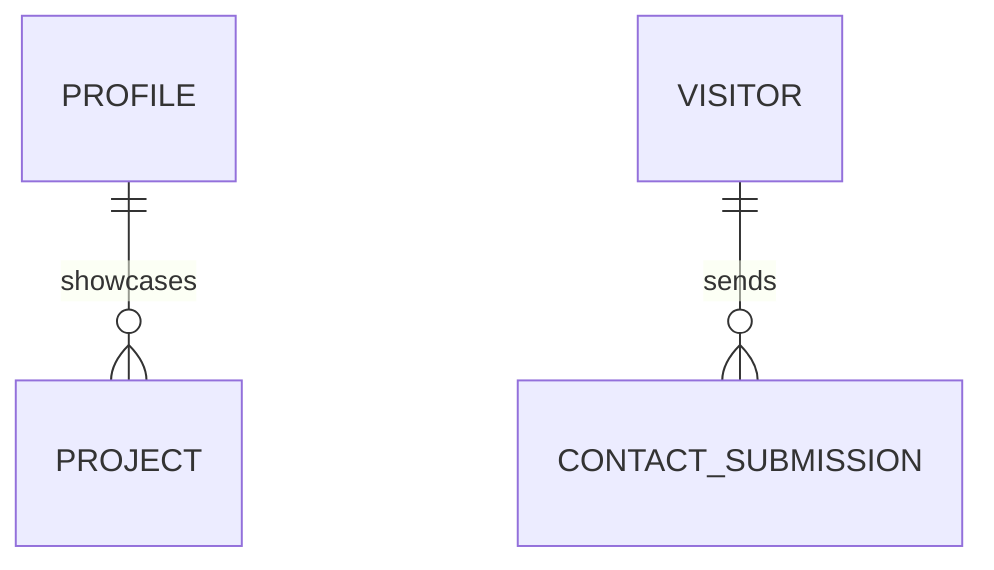

# Phase 1: Data Model & Types Specification

**Feature**: Modern Developer Portfolio
**Spec**: [spec.md](./spec.md)
**Branch**: `001-developer-portfolio`

---

## Data Entities & Schemas

### 1. Profile Metadata (`ProfileInfo`)

Represents the developer's core identity, bio, availability status, and global social connections.

| Field       | Type                                        | Required | Description                                                         |
| ----------- | ------------------------------------------- | -------- | ------------------------------------------------------------------- |
| `name`      | `string`                                    | Yes      | Full developer name                                                 |
| `headline`  | `string`                                    | Yes      | Primary professional title (e.g. "Senior Full-Stack & UI Engineer") |
| `bio`       | `string`                                    | Yes      | Detailed introductory bio paragraph                                 |
| `status`    | `'available' \| 'busy' \| 'open_to_offers'` | Yes      | Current availability badge state                                    |
| `socials`   | `SocialLink[]`                              | Yes      | Array of social platform links                                      |
| `resumeUrl` | `string`                                    | Yes      | Relative or absolute path to downloadable resume PDF                |

#### Sub-type: `SocialLink`

- `platform`: `'github' | 'linkedin' | 'twitter' | 'email' | 'scholar'`
- `label`: `string`
- `url`: `string`
- `icon`: `string` (Lucide icon identifier)

---

### 2. Project Entity (`Project`)

Represents a portfolio project showcase card and modal payload.

| Field         | Type       | Required | Description                                                               |
| ------------- | ---------- | -------- | ------------------------------------------------------------------------- |
| `id`          | `string`   | Yes      | Unique slug identifier (e.g. `"ai-agent-workbench"`)                      |
| `title`       | `string`   | Yes      | Display title                                                             |
| `tagline`     | `string`   | Yes      | Short 1-sentence summary                                                  |
| `description` | `string`   | Yes      | Full markdown or rich text project description                            |
| `coverImage`  | `string`   | Yes      | Path to hero preview image or thumbnail                                   |
| `tags`        | `string[]` | Yes      | List of technology stack tags (e.g., `["Next.js", "GSAP", "TypeScript"]`) |
| `highlights`  | `string[]` | Yes      | Key technical impact & architectural highlights                           |
| `demoUrl`     | `string`   | No       | Optional live deployment link                                             |
| `githubUrl`   | `string`   | No       | Optional repository source code link                                      |
| `featured`    | `boolean`  | Yes      | If true, pinned in top gallery section                                    |

---

### 3. Contact Form Payload & Validation Schema (`ContactInput`)

Client-side contact message form payload.

```typescript
export interface ContactInput {
  name: string;
  email: string;
  subject: string;
  message: string;
}
```

#### Validation Rules (Zod / Client-side):

- `name`: String, minimum 2 characters, required.
- `email`: String, valid email format, required.
- `subject`: String, minimum 3 characters, required.
- `message`: String, minimum 10 characters, required.

---

## State Model & Relationships


